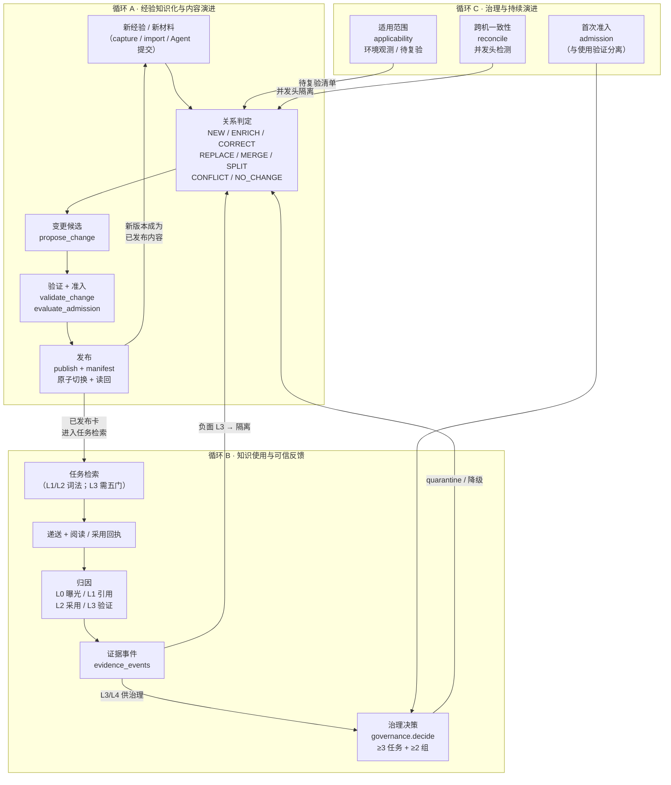
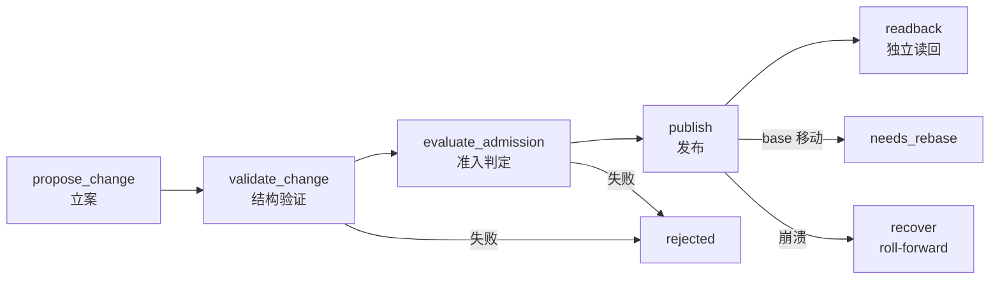
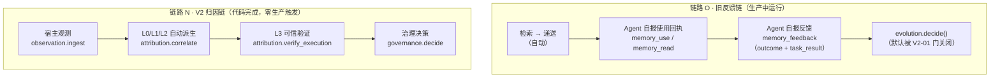
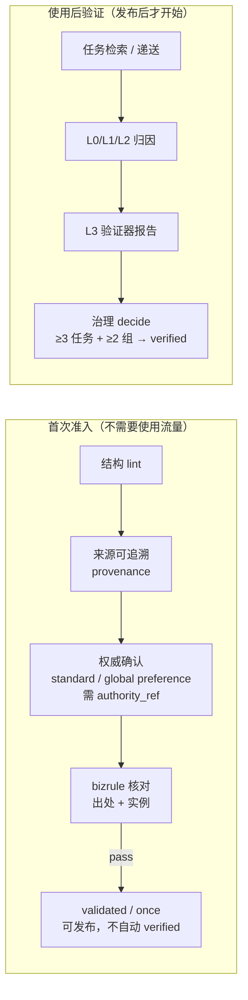

# knowbase 知识卡片全生命周期 V2：架构设计

> 状态：设计文档 v1.0（2026-11-05）。基线：`7e6f8cc`（0.2.0rc9）。
> 配套：[审计修订与设计决策记录](../reports/knowbase-lifecycle-v2-audit-reconciliation.md)、
> [实施任务书](../plans/knowbase-lifecycle-v2-implementation.md)。
>
> 本文档的定位：**V2 架构的权威设计记录**。它同时描述两层事实——
> （a）已实施的机制（V2-01..V2-18，65dfdcd，61 项新增测试，全量 1126 passed）；
> （b）尚未接线或尚未实现的环节。每节末尾以「实施状态」标注该机制在 7e6f8cc 下的真实状态，
> 避免把「函数存在」误读为「闭环已通」。实施状态的判定依据为只读代码核查
> （见审计修订文档附录 A.2），非交付记录自述。
>
> 约定：本文的「证据等级」沿用审计修订文档的 E0～E4（E1=真实运行数据、E2=隔离测试、
> E3=源码实现、E4=文档声明）；「使用证据」L0～L4 是另一套业务分层，不与 E0～E4 混用。

## 1. 设计目标与约束

### 1.1 目标

把 knowbase 建成一个**自进化的多 Agent、多人共享经验知识库**：

- 知识的晋升、淘汰、更新由 Agent 执行结果自动反馈驱动，**不需要人工参与**。
- 同一张卡可以在多台机器、多个 Agent 之间演进而不丢失版本、不静默丢弃分歧、不把一次
  任务的成功直接算成某张卡的功劳。
- 任何一次自动晋升都必须能被事后核验：谁、在哪次任务、凭什么证据、针对哪个版本。

### 1.2 硬约束（不可协商）

| # | 约束 | 来源 |
|---|---|---|
| C1 | 晋升/淘汰/更新由执行结果自动反馈驱动，**不设人工审核关卡**。唯一刻意保留的人工环节是 G15 凭据清洗 `--apply`（不可逆操作） | 产品定义（2026-10-24） |
| C2 | 绝不自动选边、绝不静默丢版本。冲突的两个版本同时保留、同时可见，等后续执行反馈自然淘汰 | B 路线隔离区裁决策略（2026-10-24） |
| C3 | Markdown 继续做内容权威；SQLite 是本地物化与运行账本；Git 是同步与版本载体。**不引入中心服务器、不引入向量数据库、不引入新存储引擎**，除非证明现有三件套不可能 | ADR-02 |
| C4 | 派生 unknown 不晋升；旧证据不转嫁新版本；无权威不激活规范卡 | 审计修订 §6.2 底线 |
| C5 | 唯一固定运行环境：`~/.knowbase/runtime/venv/bin/python`，原地安装，不建并行运行包 | 仓库 AGENTS.md |
| C6 | frontmatter 计数与 max() 跨机聚合**明确禁用**（无撤销、无独立性、无版本、无因果去重） | 审计修订 §4（已撤回） |

### 1.3 优先级

1. **准确性与证据可信度**——错误晋升比漏晋升更贵。
2. 性能、维护性与成本——在不牺牲第 1 优先的前提下优化。

### 1.4 术语

| 术语 | 含义 |
|---|---|
| 卡片（card） | 一条 Markdown 知识文件 + frontmatter（id、type、scope、confidence、status、content_revision 等） |
| 内容版本（content revision） | 卡片正文的规范化哈希身份。v1 = 规范化字段 SHA256 前 16 位；v2 = 完整 SHA256，纳入 applicability/claims/importance |
| 不可变修订（immutable revision） | 一次发布版本的只读快照（原字节 + hash），写入后不 UPDATE，文件被篡改报 `SNAPSHOT_HASH_CONFLICT` |
| 变更候选（change proposal） | 对已发布内容的一次拟议修改，带关系类型、base heads、outputs、claim 映射、source dispositions；候选**不覆盖**已发布版本 |
| 证据事件（evidence event） | 一次可核验的使用/验证观测，带 subject_revision（`memory_id@content-v1:revision`）、logical_task_key、trust_basis、level（L0～L4） |
| 治理决策（governance decision） | 对（卡片，版本）的确定性投影：verified / validated / unverified / quarantine，由 evidence_events 集合重算得出 |
| 独立任务（independent task） | 以 `logical_task_key` 去重的任务身份；同任务 N 次重放仍计 1 |
| 独立组（independence group） | `independence_group`；同一组的多个任务不扩票 |

## 2. 三闭环总览

V2 替代九阶段线性模型，采用三个互相独立又互相供料的闭环（ADR-01）。

三个循环的输入输出边界：

| 循环 | 输入 | 输出 | 不碰的东西 |
|---|---|---|---|
| A 内容演进 | 新经验、新材料、治理/适用范围的待处理信号 | 新的已发布版本（+ 不可变快照 + manifest） | 不决定卡片是否「可信」；不读使用反馈计数 |
| B 使用反馈 | 任务检索、Agent 工具调用、验证器报告 | evidence_events（L0～L4） | 不修改卡片内容；不直接晋升/降级任何卡 |
| C 治理演进 | evidence_events、环境观测、跨机证据包 | 治理决策（verified/validated/unverified/quarantine）、待复验清单、并发头隔离 | 不生成新正文；治理字段不产生新 content revision |

**关键分离**：内容演进（改什么）与状态变化（信不信）是两个不同的操作，由不同的机制、
不同的证据、不同的阈值驱动。`evolution.decide()` 只动状态，不动正文；`publication.publish()`
只发新版本，不判可信度。把两者混在一起是旧架构的根本缺陷。

## 3. 循环 A：经验知识化与内容演进

### 3.1 八种关系是提案语义，不是一套状态机

八种关系（`contracts.RELATIONS`）描述「新材料与已有知识之间是什么关系」，是**变更提案的
分类标签**，不是八套服务、八个状态机（ADR-03）。

| 关系 | 语义 | base | outputs | 风险等级 |
|---|---|---|---|---|
| NEW | 全新知识，无对应已有卡 | 无 | 1 张新卡 | 低 |
| ENRICH | 补充已有卡，不改其结论 | 1 张 | 1 张（新版本） | 中 |
| CORRECT | 纠正已有卡的错误内容 | 1 张 | 1 张（新版本） | 高 |
| REPLACE | 整体替换已有卡 | 1 张 | 1 张（新版本） | 高 |
| MERGE | 多张卡合并为一张 | 多张 | 1 张 | 高 |
| SPLIT | 一张卡拆分为多张 | 1 张 | 多张 | 高 |
| CONFLICT | 两卡结论矛盾，占位待裁决 | 2 张 | **无**（强制 `outputs=[]`，state 直接 `needs_review`） | — |
| NO_CHANGE | 重复 / 无价值，只记处置，不产卡 | 0～多张 | **无**（不可发布，只记材料处置与来源关联，绝不计为 helpful） | — |

**实施状态**：立案层（`changes.propose_change`）八种全接受；发布层（`publication.publish`）
除 CONFLICT/NO_CHANGE（设计为不可发布）外全经通用 outputs+dispositions 机制执行；
**自动识别与自动生成层全部缺失**——没有任何代码从新经验自动判断应属哪种关系、
自动生成对应的变更候选。全仓库唯一 `propose_change` 调用方是 `rollback()`（且只产 REPLACE）。
MERGE/SPLIT 无专用执行逻辑，内容合成（取哪些 claim、如何去重、拆分边界）完全依赖提案方
给出的 outputs。这是 V2 剩余工作的核心缺口之一（见任务书 W2）。

### 3.2 变更流水线：提案 → 验证 → 准入 → 发布

**立案（`changes.py:71` `propose_change`）**的不变量：

- 候选不覆盖已发布内容（只落候选 + 目标正文 spool，已发布 head 不动）。
- claim 保真：ENRICH/CORRECT/REPLACE/MERGE/SPLIT 必须给出全部旧有效 claim 的映射
  （preserved/modified/added/removed/moved；`removed` 必须带 `justification_ref`；
  verified 卡缺一个映射即拒绝立案）。无结构化 claim 的卡按整卡单 claim `C-whole` 处理。
- base heads 冻结：任一 base head 的 `content_revision` 与当前 `entity_heads` 不符即拒绝
  （`REVISION_CONFLICT`）。
- 召回快照漂移：recall snapshot 已变即拒绝（`NEEDS_REASSESSMENT`）。
- 幂等：同 change_id + 同 proposal_hash 返回既有候选；同 id 异 hash 冲突。
- 候选状态机：`proposed → validating → ready → needs_review / needs_rebase / rejected / expired / published`。

**验证（`validation.py:32` `validate_change`）**：NO_CHANGE/CONFLICT 不得带 outputs；
其余关系必须带 outputs。

**准入（`admission.py:29` `classify_risk` / `:40` `evaluate_admission`）**：

- 风险分级：bizrule 或 CORRECT/REPLACE/MERGE/SPLIT → 高风险；ENRICH → 中风险。
- `evaluate_admission` 检查结构 lint、来源可追溯、provenance、权威确认
  （standard / global preference 要求 `authority_ref`），**不检查使用流量**
  （准入与使用验证分离，ADR-06）。
- `pass` 的语义在代码中明确为「validated/once 可发布，不自动 verified」。

**发布（`publication.py:60` `publish`）**：

1. 仅 `ready` 态可发布；NO_CHANGE 不可发布；已发布返回 `ALREADY_PUBLISHED`。
2. 要求 validation 报告（`_validation_digest`）。
3. 发布前重读 base heads，任一移动即置 `needs_rebase` 并拒绝。
4. 先拍不可变快照：被替换的旧 head 补拍 revision；再写全部输出快照（`revisions.record_revision`）。
5. manifest 原子 rename = durable commit point。
6. `_materialize()`：SQLite 短事务一次切换 `published_heads` 全批；兼容镜像——
   `disposition == "active"` 的输出写正式目录 Markdown（新版本 confidence 强制重置为
   `once`，不继承 verified），其余 disposition（alias/retired/redirect）把旧卡置
   `archived`（redirect 除外，保留 active + `redirect_ids`）并写
   `archive_reason = {relation}:{publication_id}`。
7. 独立读回 `readback()`：manifest hash、heads、快照逐项核对。
8. 恢复 `recover()`：prepared 作废，published 未物化则 roll-forward（manifest 在即重建，
   不回滚已确认版本）。半发布崩溃只见全新或全旧，不见中间态。
9. 回滚 `rollback()`：走同一发布内核，以当前 heads 为 base 立 REPLACE 候选
   （claim 全映射 preserved），再发布。

**实施状态**：机制已实现 + 隔离测试通过（V2-06/07/08，6 项；e2e 3 项）。
但生产调用方只有 CLI（`lifecycle validate/publish`），**无 MCP 工具、无 worker 调用、
无自动提案方**。从「准入通过」到「卡片发布」的自动执行链缺失（见 §9 与任务书 W1）。

### 3.3 不可变版本与快照

- 修订身份：content-v1（直接复用 `mutations._compute_revision`，防口径漂移）/
  content-v2（完整 SHA256，纳入 applicability/claims/importance，缺失字段以空结构参与、
  不静默剔除）；`revision_identity` 按卡片标记派发，存量卡保持 v1 身份，历史反馈不失联。
- 快照：`revisions.record_revision`（O_EXCL 写入、同身份幂等、文件被篡改报
  `SNAPSHOT_HASH_CONFLICT` 不静默）；`load_revision` 独立读回（原字节 + 语义 + hash 校验）。
- `legacy_import`（V2-04）：含 staging；v1 身份登记；快照保留磁盘原字节 CRLF/BOM；
  dry-run；畸形/缺 id/重复 id 单列不阻断；entity_heads drift 影子单列；幂等 manifest 只写一次；
  **不写 published_heads、不动 entity_heads**（影子语义）。
- CRLF 修复（F-12）：`store.parse_text` 入口统一 CRLF/CR→LF；磁盘原字节不改写，快照审计另存原件。
- `store.iter_all` / `find_file` 只扫固定类型目录，V2 资产目录 `lifecycle/` 天然不进普通卡扫描。

### 3.4 演进检索（evolution recall）

任务检索与演进检索是**两个用途**，分开设计（ADR-09）：

| 维度 | 任务检索（task retrieval） | 演进检索（evolution recall） |
|---|---|---|
| 目的 | 给当前任务找可用的知识 | 给内容演进找「与新材料相关」的已有卡（含待演进、待复验的卡） |
| 域 | 本 scope + global；staging/stale 排除 | 本 scope + global；**staging/stale 参与**；archived 仅治理目的显式开启；跨 scope 召回为 0 |
| 召回路 | FTS/CJK/标题（+ dense，见 §4.4） | wide_recall（FTS/CJK/标题/code_refs）+ 错误码精确路（HTTP 3xx-5xx / ECONN* / ERR_* / 0x…）+ 关系邻接路（top-10 命中卡 frontmatter relations 指向的同域卡补入） |
| 快照 | 无 | 冻结快照 `knowbase.evolution-recall.v1`：purpose=evolution、query hash、候选 heads digest + **域 heads digest**（双 digest：候选被改或域内新卡出现都判漂移）、降级标记（当前 lexical_only） |
| 漂移检测 | 无 | `snapshot_changed`：提交候选前的 NEEDS_REASSESSMENT 检测基础 |

**实施状态**：`recall.evolution_recall` 已实现 + 测试通过（V2-05，6 项）。
演进语义代际（purpose=evolution）待八关系 POC 后建，当前诚实降级 lexical_only。

### 3.5 写路径总览：两条并行路径

| 路径 | 入口 | 是否经过变更提案 | 说明 |
|---|---|---|---|
| 直接写 | MCP `memory_save` → `writer.create()`；`memory_update` → `writer.update()` | 否 | 受治理类型（standard/preference/bizrule）自动进 staging；update 修订即降权（confidence 重置为 once）；带 `expected_content_revision` / `expected_governance_revision` 乐观并发校验 |
| V2 变更 | `propose_change` → `validate_change` → `evaluate_admission` → `publish` | 是 | 见 §3.2 |
| 提炼成卡 | `extraction/materialize.py`（候选 → 成卡；成功后原行置 `superseded`） | 否（走 `_apply_candidate`：create/update/link_existing/review） | 幂等重放；自动 executor 提示只允许 create/review |

直接写路径的存在是刻意的：Agent 保存一条经验不应被迫走完整的变更提案流程。
但直接写**不产生**关系判定、不产生 claim 映射、不经过多卡原子发布——
需要这些保证的演进操作必须走 V2 变更路径。两条路径的适用边界由调用方（Agent / worker / CLI）
按操作性质选择，不由系统事后猜测。

## 4. 循环 B：知识使用与可信反馈

### 4.1 证据分层 L0～L4

使用证据分五层，**只有 L3 能进治理，L4 是独立复现的最高级**（ADR-05）。

| 层 | 名称 | 含义 | 治理效力 | 生产者 |
|---|---|---|---|---|
| L0 | 曝光（exposed） | 卡被递送给某次任务 | 仅分析，零治理票 | `attribution.correlate`（读 `retrieval_deliveries`） |
| L1 | 引用 / 阅读（referenced / read） | 同会话 `knowledge_uses` 状态 ∈（read, referenced） | 仅分析，零治理票 | `attribution.correlate`（读 `knowledge_uses`；注意 `adopted` 状态**不计入** L1） |
| L2 | 采用（adopted） | 卡的动作签名与该会话工具调用负载精确命中且不歧义 | 只可限幅排序，零治理票 | `attribution.correlate`（确定性匹配器） |
| L3 | 独立执行验证（verified-effective） | 已登记验证器的报告：artifact_hash + checks 全 pass（或 fail → 负面 L3） | **唯一治理输入**（与 L4 并列） | `attribution.verify_execution`（需注册验证器） |
| L4 | 独立复现（independently-reproduced） | 同一结论由独立任务/独立环境复现 | 治理输入 | **无生产者**（全仓库无任何 L4 赋值点；定义与判定条件无法从代码确定） |

**三条铁律**：

1. **检索 ≠ 采用**：检索命中只是候选，只有进入最终 `candidates` 的卡才写递送；
   递送 ≠ 阅读；阅读 ≠ 采用；采用 ≠ 有效。每一层跃迁都需要独立的证据。
2. **任务成功不反推采用**：任务 completed 不发任何卡的奖。成功可能是卡的功劳，
   也可能与卡无关——系统不猜。
3. **Agent 自报不是 L3**：`verification_source`（agent_report / user_confirmed / independent）
   是调用方声明的字符串，不认证任何执行验证。`independent` 只是个标签，不产生可信度。
   L3 只认已登记验证器的报告。

### 4.2 两条并行的链：旧反馈链与 V2 归因链

当前系统里存在**两条互不相交**的链，必须严格区分，不能混用数字。

#### 链路 O 各环节（生产中）

| 环节 | 机制 | 自动 / 自报 |
|---|---|---|
| 检索 → 递送 | `context.execute` 写 `retrieval_deliveries`；`delivery_id = "DEL-" + digest(search_id, memory_id, content_revision)`，同 search 同卡同版本幂等 | 自动（服务端行为） |
| 递送 → 使用回执 | MCP `memory_read` / `memory_use` → `consumption.record()`；状态集合 referenced / adopted / irrelevant / unverified（另 read 仅限 reading 路径） | **半自动**：Agent 须调用读取工具，但回执由工具调用自动生成并经确定性校验 |
| 使用回执校验门 | `context_event_id` 必须在 `context_events` 中存在；非 reading 状态要求该卡 + 版本确在当次递送候选内；`adopted/referenced/read` 要求当前版本且卡为 active（staging 拒绝） | 确定性校验 |
| 使用回执 → 反馈 | MCP `memory_feedback` → `versioned_feedback.apply`；绑定三元组（use_id ∧ task_outcome_id ∧ expected_content_revision）三者齐全，任一缺失而其余存在 → `INCOMPLETE_FEEDBACK_BINDING` | **自报**：outcome、task_result、verification_source 均由调用方传入；代码校验绑定完整性与一致性，不认证真实性 |
| 反馈 → 治理 | `evolution.decide()`；默认 `trusted_promotion_enabled=False` 时直接返回 promote=retire=False，反馈只作观察 | 默认关闭 |

**旧 decide() 的口径**（门打开时才生效）：晋升需独立 helpful 任务 ≥3、独立会话 ≥2、
零阻断；`incorrect`/`outdated` 或负面任务 ≥2 → 淘汰（stale）；计数只认当前内容版本、
同任务重复反馈不增加证据。`decide()` 本身是纯判定函数（无写操作），状态变更由唯一调用方
`versioned_feedback.apply()` 执行。

**两套「采用」概念并存且互不读取**：`consumption` 的 `adopted` 状态（Agent 自报）与
`attribution` 的 L2 `knowledge.adopted` 事件（确定性匹配派生）是独立机制。
任何统计必须注明是哪一套，不得混算。

#### 链路 N 各环节（V2 归因链）

**观测层 V2-09（`observation.ingest`）**：原生事件幂等落账（同 key 同 hash 零增量、
同 key 异 hash 记冲突不覆盖）、tool_call/result 按 tool_call_id 配对（未配对进 gap_flags 不猜）、
task_runs 维护（identity_basis=native/local_segment，logical/origin 键来自 contracts，
unknown 显式）、artifact_set_hash、completion 只记终态不推知识有效。
前置修复：`normalizer.normalize_events()` 把复合 content 的每个 tool_use/tool_result
独立成事件、各自保留 tool_call_id（旧逻辑把同消息多调用压成一个、id 被最后一个覆盖）。

**L0/L1/L2 自动派生 V2-10（`attribution.correlate`）**：

- L0：递送记录存在即记（读 `retrieval_deliveries`）。
- L1：同会话 `knowledge_uses` 状态 ∈（read, referenced）即记。
- L2：卡的动作签名（`code_refs` 路径、`code:` 引用、正文带 `/` 或 ≥8 字符的文件路径）
  与该会话 `native_events` 中 tool_call 负载 token 精确命中；通用命令
  （pytest、git status/log/diff、ls、cat、pwd 等）进 `generic_rejected` 不作采用；
  纯文本相似不算；同 token 命中多张已递送卡 → ambiguous，**不发 L2 事件**。
- 事件落 `evidence_events`（本地 ledger），`subject_revision = "memory_id@content-v1:revision"`，
  `event_id` 由 `contracts.stable_event_id` 稳定派生。

**L3 可信验证 V2-11（`attribution.verify_execution`）**：

- 硬门：① validator 已在配置 `knowledge_lifecycle.validators` 登记；
  ② 报告含非空 `artifact_hash` 与至少一个 check；
  ③ checks 引用的 `claim_id` 必须存在于卡（防「跑过测试但没测该卡断言」）。
- 判定：checks 全 pass → pass（positive L3）；任一 fail → fail（negative L3）；
  缺失/不确定 → unknown（neutral L3）；未知 claim → unknown。
- unknown 的处理：报告通过硬门但 checks 不确定 → **持久化**为 `validation.completed` 事件
  （outcome=unknown，polarity=neutral，level=L3）；验证器未登记 / 空报告 / 目标缺失 →
  返回错误 dict，**不记录任何事件**。
- Agent 自报（含 `verification_source=independent`）一律不是 L3：无登记验证器则返回
  `VALIDATOR_NOT_REGISTERED` 错误，不产生事件。

**实施状态**：链路 N 代码完整 + 测试通过（V2-09 6 项、V2-10/11 3 项），但
`observation.ingest`、`attribution.correlate`、`attribution.verify_execution` 在
`knowbase/` 内**均无生产调用方**（仅测试调用）；worker 无对应 handler；仓库内无任何
validator 适配器实现；默认配置无 `validators` 键。接线是剩余工作的第一优先（任务书 W1）。

### 4.3 证据事件的版本绑定

- 内容版本：`content_revision` = 规范化字段 SHA256 前 16 位 hex（content-v1）；
  content-v2 为完整 SHA256 且纳入 applicability/claims。
- 反馈绑定三元组：`(use_id, task_outcome_id, expected_content_revision)`；
  `task_key = digest(host, session, task_id, task_revision)`；
  去重键为 `(memory_id, content_revision, task_key, task_outcome_id, binding='version_task')`。
- 证据事件绑定：`evidence_events.subject_revision = "memory_id@content-v1:revision"`；
  治理按 `(memory_id, revision)` 逐版本决策。
- 任务证据 ID：`"EV-" + digest(task_outcome_id, use_id, memory_id, revision)[:24]`，
  `INSERT OR IGNORE` 保证重放不重复记。
- **旧证据不转嫁新版本**：卡片修订后，新版本 confidence 强制重置为 `once`；
  旧版本的 L3 证据保留在旧版本上，不自动计入新版本。

### 4.4 检索：L1/L2 词法与 L3 语义的五门

任务检索分三级（`retrieval_policy.local_policy` 只产生 L1/L2；dense 只在
`origin ∈ {mcp_search, mcp_context}` 时尝试）：

| 级别 | 含义 | 条件 |
|---|---|---|
| L1 | 原始 FTS | 默认 |
| L2 | FTS + 别名扩展 | 默认 |
| L3 | 词法 + dense（RRF k=60 融合，再乘 scope/confidence/新鲜度/反馈因子排序） | 需通过全部激活条件（见下） |

**dense 激活的完整必要条件链**（缺一不可）：`embedding.enabled=True` + 配置了有效 provider +
存在 `ready`/`active` 代际 + 冻结 v2 报告通过 `quality()` + coverage ratio == 1 + probe 健康。

**向量索引代际模型**（`semantic_index`）：`embedding_generations` 表，
状态机 `building → ready → active` + `retired`；同一时刻只有一个 active 代际，
由 `retrieval_active` 单例指向。`build()` 跨代复用同 hash/同 revision 向量，
文档向量为 chunk 均值（chunk_chars 默认 6000、max_chunks 默认 8）；
`prune()` 只保留 active + 最新 ready + 最新 retired 代的向量。

**freeze_report v2 五门**（`retrieval_evaluation.freeze_report`，全过则 verdict=PASS）：

| 门 | 判定 |
|---|---|
| quality | hybrid 臂 Recall@5 ≥ 词法臂 Recall@5，且 ≥ 绝对下限 0.5 |
| rejection | 真负例存在且 hybrid 的 correct_rejection ≥ 词法臂 |
| regression | 配对 D-B Recall@5 的 CI95 下界 ≥ 0（按任务簇 bootstrap；无簇键回退逐 query bootstrap 并在 method 中声明） |
| latency | 真实混合路径端到端 p95 ≤ 1000ms 且 `latency_basis='end_to_end_hybrid'`（只交离线词法计算延迟不能满足） |
| samples | 可判定样本（positive + negative + irrelevant）≥ 60，且 positive ≥ 20、negative ≥ 20；`unknown` 不计入任何最低样本数 |

**`quality()` 15 项校验**（`semantic_index.py:47`）：只认 v2 报告；任一条件不满足即返回 None
（不激活）。v1 报告可读但无激活效力。`dense_min`（余弦阈值）取自报告本身，不是代码常量。

**降级**：多层 reason 标注（not_configured / quality_unvalidated / index_incomplete /
probe_pending 等）+ 断路器（quarantined / 900s 退避 / 指数退避）；无模型时
`measure_end_to_end_p95` 如实返回 `lexical_only`。不抛错、不静默。

**影子评测**：`shadow_observe` 函数存在（`retrieval_metrics.py:47`），`report()` 单列影子段、
不计入 executed_queries——但**生产代码中无任何调用点**，仅一项测试调用。
「影子观测接口已实现」为真；「在线影子观测正在运行」为假。

**实施状态**：代码默认 `embedding.enabled=False`；仓库内无冻结报告文件。
生产实际激活状态未确定（取决于用户本机配置与数据库，不在仓库内）。
V2-03 交付记录「真实语义收益评测 external_pending，检索保持 L2」与代码一致。

## 5. 循环 C：治理与持续演进

### 5.1 治理决策（V2-12）

`governance.decide()` 是纯函数式确定性决策（同输入集合 digest 输出一致）：

- 只认 `evidence_events` 中未撤销、`trust_basis=registered-adapter` 的 L3/L4 事件；
  **L0/L1/L2 永远零治理票**。
- 独立性按 `logical_task_key` 去重（同任务 100 次重放仍计 1）；同 `independence_group` 不扩票。
- 反证门：同版本存在未裁决的 trusted fail → 决策 `quarantine`。
- 阈值：≥3 独立任务且 ≥2 独立组且无未裁决反证 → `verified`；有正证据但不足 → `validated`；
  无证据 → `unverified`。
- 撤销后重算，支持不足可降回 validated（不自动清零）。

`apply_decision()`：verified 晋升（confidence once→verified）；quarantine 映射为
`status=stale` + `quarantine_reason`（不删内容）；治理字段不产生新 content revision。

**nuance（已核实）**：`contracts.logical_task_key()` docstring 称「unknown 不参与独立性计数」，
但 `governance.decide()` 代码中没有过滤 `unknown:` 前缀——一个 `unknown:repo:X` 键会被计为
1 个任务。缓解因素：同一项目的所有 unknown 任务折叠为同一个键，且本地派生事件的
`independence_group` 等于 `logical_task_key`，故 unknown 最多贡献 1 任务 + 1 组，
无法单独达到 3 任务 + 2 组的晋升阈值。但 docstring 声称的「不参与」在代码中并未字面实现，
属文档与代码不一致（见审计修订附录 A.3）。

**实施状态**：`decide()` / `apply_decision()` / `recompute_all()` 已实现 + 测试通过，
但 `apply_decision` / `recompute_all` 的唯一调用方是 `reconcile.materialize_and_recompute()`，
而后者本身在 `knowbase/` 内零生产调用。治理重算链未接线。

### 5.2 安全门（V2-01）

| 开关 | 默认值 | 作用 |
|---|---|---|
| `trusted_promotion_enabled` | `False` | `evolution.decide()` 在计算 promote/retire 之前先检查；若不可用，直接返回 promote=False、retire=False、`blocked_reason="trusted_validation_unavailable"`。证据计数仍正常计算并返回（供展示），只有治理动作被拦 |
| `legacy_promotion_enabled` | `False` | 控制 `versioned_feedback.py:218` 的独立旁路：无 `task_result` 的两工具标签 helpful 反馈达到 2 且 ≥2 个工具时 once→verified。默认关闭；且该旁路要求 `not staged`，本身不能激活 staging 卡 |
| `evolution.enabled` | `True` | 为 False 时 decide() 返回 `blocked_reason="evolution_disabled"` |
| `feedback_ranking_factor_enabled` | 默认关闭（中性） | 检索排序中的反馈计数因子；V2-18 列为待删项（保留回滚开关一轮） |

安全门的设计意图是**过渡保护**，不是永久关卡：V2-12 证据治理接管后，
`evolution.decide()` 的 trusted_promotion_enabled 过渡开关应被移除，改为只消费
evidence_events（V2-18 清单第 2 项）。在移除之前，任何「自动晋升已恢复」的说法
都必须指明是哪个开关、什么配置，否则是误导。

### 5.3 适用范围（V2-15）

- `observe_environment`：environment.observed 事件 + 适用范围冲突卡生成待复验清单——
  **mismatch 只限制该环境推荐，不判卡错、不删内容**；无结构条件老卡 unknown 不批量判过期。
- `evaluate_card` / `spec_matches`：可解析版本约束（>=2,<3 / 2.x）；不可解析回 exact/unknown 不猜。
- `archive_protection` 接入 `lifecycle.auto_archive_sweep`：critical / keep_reason /
  复验中 / 隔离冲突阻止自动归档（时间衰减只表示「需复核」）。
- **低频重要卡不按低点击淘汰**（ADR-11）：使用频率不是正确性；失效作用到版本/适用范围，
  不是整卡删除。

### 5.4 失效与复活

| 转变 | 触发 | 机制 |
|---|---|---|
| active → stale（淘汰） | 旧链：`incorrect`/`outdated` 或负面任务 ≥2；新链：可信 L3 反证 → quarantine | `versioned_feedback.apply` / `governance.apply_decision`（映射为 status=stale + quarantine_reason） |
| stale → active（复活） | 新证据通过验证 | 旧链：`promote=True` 且卡为 stale + 带 `revalidation_pending` 标记时，status → active，清除标记；新链：ENRICH 修订发布 → 新版 once（旧票不转嫁）、旧版本证据保留、治理重算 unverified |
| stale 非治理卡复验 | — | **无专用路径**（F-08 遗留）：`status=stale` 不在 validation_candidates SQL 中，非 GOVERNED stale 卡没有同等复验路径 |

## 6. 跨机协同

### 6.1 两层交换：统计层与治理层

系统里有**两套不同层的交换机制**，共存、零代码连接，不得混淆：

| 维度 | exchange_v2（统计层，P3） | V2-13 签名证据包（治理层） |
|---|---|---|
| 交换内容 | value 事件（递送/使用/反馈/任务结果） | 仅可信 L3/L4 治理证据事件 |
| 目标表 | `agg_events`（聚合分析库，只做统计） | `evidence_events`（本地治理账本） |
| 签名 | 无（哈希完整性 only） | Ed25519 信封签名 + 信任登记 |
| 撤销 | 无 | tombstone 撤销（撤销先到保留，原事件后到仍无效；重放不能复活） |
| 生产接线 | Worker 每 900 秒（默认关闭） | **无任何生产调用方** |
| 影响治理 | 否（只做统计） | 是（`governance.decide` 读 `evidence_events`） |

### 6.2 exchange_v2（统计层）

- 交换对象：只交换价值事件，不交换卡片、知识内容或证据账本。唯一来源是本地 `value_outbox` 表。
- 白名单事件类型共 11 种：`retrieval.delivered`、`knowledge.used`、`knowledge.read`、
  `knowledge.created`、`knowledge.revised`、`knowledge.archived`、`knowledge.activated`、
  `knowledge.delivered`、`task.completed`、`task.abandoned`、`feedback.recorded`。
- 包内不含知识正文、查询、原始工具结果、硬件标识或凭据（白名单外字段整条拒绝）。
- 包格式：schema `knowbase-value-events-v2`，包 ID 为 `PKG2-` + 规范 JSON 的 SHA256 前 20 位；
  上限每包最多 1000 个事件、1 MiB（v1 为 20000 事件 / 64 MiB）；超限返回 `PACKAGE_TOO_LARGE`，
  `export_events` 会自动减半重试以保证有界推进。
- 传输：走独立证据分支（默认 `knowbase-value-events-v2`），位于独立证据根目录
  （默认 `~/.knowbase/evidence`）的 Git 仓库，与知识 Git 同步是两套机制。
  发送：写包上分支 → 推送 → 读回比对 `package_id` 一致才算 sent，否则留待重发同包；最多 3 次重试。
  接收：拉分支 → 导入未处理包 → 回执写回同分支；已导入且有回执的跳过。
  ACK：发送端拉回执后，按本地 outbox 原始事件重算剥离哈希逐条核验，一致且结果为
  accepted/duplicate 才标记 acknowledged；「上传返回成功」本身不 ACK；
  缺失/不匹配保持 pending，收据丢失时重发同包。
- 去重：传输幂等以 `(team_id, event_id)` 查 `agg_events`，同 ID 同 `payload_hash` → duplicate；
  同 ID 异 hash → conflict（隔离，不进治理）。包级完整性：`event_ids` 列表须与 events 一致，
  包 `payload_hash` 须与逐事件哈希重算一致，否则 `PACKAGE_MALFORMED`。
- **同一任务多机重复执行：传输层不去重**。`event_id` 默认是随机 UUID，两机跑同一任务产生不同
  `event_id`，都会被 `agg_events` 接受。任务级去重只存在于治理链（decide 按 `logical_task_key`
  去重），不在 exchange_v2 内。
- 限制：不支持实时同步（唯一触发是 worker 每 900 秒轮询）；**默认关闭**（两道门——
  `value.events_enabled` 默认 False，`evidence_role` 默认 `"off"`）；无签名/身份认证
  （信任依赖 Git 传输身份与 `team_id` 匹配）；不交换卡片内容（知识卡片同步走另一条机制
  `gitops.sync_before_read`，按 TTL 拉取知识 Git）。

### 6.3 V2-13 签名证据包（治理层）

- 签名：Ed25519（`cryptography` 库），覆盖 `schema + event_id + 信封哈希`
  （信封哈希含 issuer/team/scope/subject/payload 与 key_id）；
  密钥对生成 `generate_keypair()`，私钥 PEM 永不入事件包/知识 Git。
- 信任登记：`load_trust_registry()` 读 JSON 文件
  `{issuers: {installation_id: {public_pem, scopes, role}}, key_epochs: {key_id: {public_pem, revoked}}}`；
  `check_issuer()` 返回 `trusted / unknown_issuer / unknown_key / key_revoked / scope_not_granted`。
  密钥轮换保留旧公钥；历史未签名事件不能事后补签沿用原 event_id/hash。
- 导出：只选 `evidence_events` 中 `level IN ('L3','L4') AND trust_basis='registered-adapter'
  AND import_state='local'` 且未被撤销的事件，逐条包成签名信封；包 schema 为
  `knowbase.lifecycle.evidence-package.v1`。包不携带正文/命令输出（白名单 payload）。
- 导入：先收撤销（乱序安全）→ 信封校验 → 信任与验签 → 传输幂等 → 业务去重 → 撤销物化。
- 三层去重：① 传输幂等（同 `event_id` + `payload_hash` 只收一次；同 ID 异 hash →
  `IDEMPOTENCY_CONFLICT`，记 `event_id:conflict` 隔离行）；② 业务去重（同 subject +
  `logical_task_key` + `origin_run_key` + `check_id` 的同语义证据只计一次，换包/换设备复制不扩票）；
  ③ 独立性聚合（治理按 `logical_task_key` 计数）。
- 未验签/未登记/越 scope 的事件：**仅计数，不入库**（`stats["unverified"] += 1` 后跳过，无 INSERT）。
  注意：模块 docstring 称「保留 external_unverified 观察」，但代码中该分支无任何 INSERT——
  文档与代码不一致（见审计修订附录 A.3）。
- **接线状态**：`evidence.export_package` / `import_package` 在 `knowbase/` 生产代码中零调用；
  无 CLI 子命令，无 worker handler。V2-13 是已实现 + 测试验证，但未接入任何生产路径。

### 6.4 跨机一致性（V2-14）

- `detect_divergent_heads`：按 publication manifest before/after 检测并发版本头
  （两机各发 r2a/r2b → 隔离待显式合并，不 last-writer 获胜）。
- `sync_state`：本机证据/撤销/发布水位（离线服务最后确认版本 + as_of 语义）。
- `materialize_and_recompute`：导入后本地重算幂等入口（接收机必须重算，
  同步来的 decision 只是可核验声明）。
- **Git 同卡冲突（B 路线）**与语义矛盾是两套机制：前者由 `quarantine.py` + `gitops.py`
  处理（隔离 + 证据强度自动裁决，打平或双方均有负面证据 → 保持 open 不选边）；
  后者由 CONFLICT 提案 + `governance.decide()` 处理（见 §3.1、§5.1）。
  语义矛盾无自动发现机制。

## 7. 数据模型

### 7.1 权威划分（ADR-02）

| 资产 | 权威源 | 说明 |
|---|---|---|
| 已发布卡片内容 + 治理投影 | Markdown（正式目录） | frontmatter 含 id、type、scope、confidence、status、content_revision、quality_state 等 |
| 不可变版本快照 | `lifecycle/` 下快照文件（O_EXCL 写入） | 原字节 + hash；`knowledge_revisions` 表登记 |
| 变更候选与发布 manifest | SQLite（`publication_batches`、`published_heads`）+ manifest 文件 | manifest 原子 rename 为 durable commit point |
| 反馈 / task_outcomes / write_intents 等持久账本 | SQLite | **不是从 Markdown 可完整重建的缓存**（审计修订 §3 存储权威纠正）；删 SQLite 不能无损重建所有状态 |
| 使用证据（L0～L4） | SQLite `evidence_events`（本地 ledger） | 治理的唯一输入源 |
| 统计事件（value） | SQLite `value_outbox` → `agg_events`（聚合库） | 只保存统计证据，不是第二套知识权威 |
| 向量索引 | SQLite `embedding_generations` / `embedding_index` + `retrieval_active` 单例 | 代际模型；见 §4.4 |

### 7.2 核心表（V2 新增，迁移 v30～v34）

| 表 | 用途 | 关键约束 |
|---|---|---|
| `knowledge_revisions` | 不可变修订登记 | PK(memory_id, revision_algo, content_revision)；snapshot_hash UNIQUE；写入后不 UPDATE |
| `publication_batches` | 发布批次 | manifest hash、before/after heads |
| `published_heads` | 已发布版本头 | 当前每个（memory_id）的已发布 revision |
| `task_runs` | 任务运行身份 | UNIQUE(project_key, origin_run_key) 仅 identity_basis='native' 的部分索引 |
| `evidence_events` | 治理证据账本 | subject / logical / revokes 三索引；v34 补 claim_id / key_id / scope 列 |
| `native_events` | 宿主原生事件 | PK(host, session, native_key)；payload_hash、artifact_hash、tool_call_id 索引 |
| `embedding_generations` | 向量代际 | generation_id / provider_fp / space_id / state / expected/completed_count / quality_digest |
| `retrieval_active` | active 代际单例 | singleton=1 |
| `embedding_index` | 向量行 | generation_id / entity_id / content_hash / content_revision / dimension / vector_checksum |

### 7.3 卡片 frontmatter 关键字段

- `id`（稳定身份）、`type`（pitfall / standard / decision / workflow / preference / reference / bizrule）、
  `scope`、`confidence`（staging / once / verified）、`status`（active / stale / archived）、
  `content_revision`（v1 16 位 hex 或 v2 完整 SHA256）、`quality_state`、
  `publication_id`、`redirect_ids`（MERGE/SPLIT 后旧卡指向新卡）、
  `archive_reason`（`{relation}:{publication_id}`）、`quarantine_reason`、
  `revalidation_pending`、`stale_since`、`verified_content_revision`、`last_verified`、
  `provenance`、`authority_ref`（standard / global preference 准入用）。

### 7.4 治理类型

`GOVERNED = {standard, preference, bizrule}`。三类在有 provenance 和开关时都可自动激活。
不能沿用旧文档「standard/global preference 永远人工」的事实声明——V2 选择恢复其权威确认门，
是新设计决策，而非现状描述。

## 8. 事件契约

### 8.1 信封格式（`knowbase.lifecycle.events.v1`）

- canonical JSON（拒 NaN、键序稳定）；稳定 event_id（同输入同 ID）；
  envelope_hash 覆盖 issuer/subject/payload；`build` / `validate` / 篡改检出。
- 任务身份：`project_key` / `logical_task_key` / `origin_run_key` / `independence_group`，
  未知显式 `unknown:` 前缀（不静默填补）。
- 变更 manifest 校验：八关系 / R0-R3 / base_heads / outputs / source_dispositions /
  claim_map；NO_CHANGE 无输出、NEW 无 base、redirect 必带目标。

### 8.2 事件类型总表

| 事件 | 层 / 来源 | 关键字段 | 去向 |
|---|---|---|---|
| `knowledge.exposed` | L0 / correlate | subject_revision、delivery 引用 | evidence_events（neutral） |
| `knowledge.referenced` | L1 / correlate | subject_revision、use 引用 | evidence_events（neutral） |
| `knowledge.adopted` | L2 / correlate | subject_revision、动作签名命中 | evidence_events（positive） |
| `validation.completed` | L3 / verify_execution | claim_id、checks 摘要、artifact_hash、outcome（pass/fail/unknown） | evidence_events（positive / negative / neutral） |
| `evidence.revoked` | 撤销 / evidence.import | 被撤销 event_id、tombstone | evidence_events（import_state='revoked'） |
| `environment.observed` | 适用范围 / applicability | 环境指纹、版本约束 | 待复验清单 |
| value 事件 ×11 | 统计层 / exchange_v2 | 见 §6.2 | agg_events |
| `conflict.quarantined` | Git 冲突 / quarantine | 本地/远端/合并三份原文引用 | card_conflicts 表 |

### 8.3 证据事件的信任基础

`trust_basis` 取值：`registered-adapter`（唯一治理有效值）、`deterministic_matcher`（L2）、
以及其他未注册来源。`governance.decide()` 只认 `trust_basis=registered-adapter` 的 L3/L4。

## 9. 首次准入（staging）

首次准入与使用后验证**分离**（ADR-06）。这是 V2 对旧架构最关键的结构修正。

### 9.1 旧问题

旧架构把 staging 卡的首次激活绑定在使用反馈上，形成三重耦合：

1. 默认检索排除 staging（`search()` 加 `staging = 0 AND status = 'active'`），卡不可见；
2. 唯一曝光通道是 `validation_candidates`（每次最多 3 条，按 `updated` 排序），
   候选按时间选取而非任务相关性，三条上限可能长期遮挡其他候选；
3. 验证依赖 Agent 主动按 MCP 指令执行多步操作（context → read → 绑定反馈），且反馈结果自报。

这不是绝对的逻辑死锁（通道在代码层面存在），但准入与发布后验证耦合、曝光覆盖有限、
依赖 Agent 自报——作为「首次激活」的机制是不安全且打扰的。

### 9.2 V2 的分离设计

- `admission.evaluate_admission()` 检查结构、来源、provenance、权威确认，**不检查使用流量**。
- `pass` 的语义明确为「validated/once 可发布，不自动 verified」。
  首次发布只解决「这张卡能不能见人」，可信度（verified）永远来自发布后的 L3 证据积累。
- 风险分级（`classify_risk`）：bizrule 或 CORRECT/REPLACE/MERGE/SPLIT → 高风险；
  ENRICH → 中风险。

### 9.3 现状与缺口

**现状**：admission 机制在设计层面解决了「准入判定不需要使用流量」的问题（V2-08）。
**缺口**（实施层面）：

- admission → 发布链路存在但未自动接线，生产代码中的调用方只有 CLI
  （`lifecycle confirm → 提案 → validate → publish`，其中提案一步目前甚至没有 CLI 入口，
  只有 rollback 能建 change）。
- 默认配置下 V2-01 门关闭 decide() 的晋升出口，staging 卡的首次激活实际依赖人工操作
  （`knowbase promote` 或 `lifecycle.human_verify`）。
- `status=stale` 不在 validation_candidates SQL 中，非 GOVERNED stale 卡没有同等复验路径。

**结论**：这不是逻辑死锁，而是**自动执行链路缺失**。接线任务见任务书 W1。

### 9.4 staging 卡的创建与可见性

- 创建：`adapter_create` 中，`staging = meta.confidence == "staging" or dtype in
  ("standard", "preference", "bizrule")`。受治理三类写 `repo/staging/{mid}.md`；
  其它类型写正式类型目录。`store.load()` 经 `find_file()` 在全部目录（含 staging）中查找，
  按 id 加载不受 staging 影响。
- 检索：默认 `include_inactive=False` 时 staging 卡不在 SQL 候选集内。
  MCP `memory_search` 默认不传 `include_inactive`，即默认排除。
- 按 id 读取：`memory_read(id)` 可读 staging 卡全文，不产生检索命中；staging 卡 head 标注
  「候选未激活；业务规则验证后可带 read_use_id 与 task_result 回填」。
- 任务上下文曝光：`memory_context` 建立任务上下文时，额外查询
  `m.staging=1 AND m.status='active'` 的 standard/preference/bizrule（按 scope，最多 3 条，
  按 `updated` 排序），以 `validation_candidates`（`mode: "validate_only"`）返回。
  MCP 系统提示明确要求 Agent「仅在本任务相关时关联 memory_read……依据 provenance 和实际检查
  验证后 memory_feedback」。
- read 回执放行点（`consumption.py`）：`context_event_id` 必须存在于 `context_events` 表
  （不能凭空编造）；`state="read"` 时跳过 `CANDIDATE_NOT_DELIVERED` 检查和
  `KNOWLEDGE_NOT_ACTIVE` 检查（staging 卡可读）；但 `state="adopted"/"referenced"` 时
  staging 卡会被拒。
- 反馈验证分支（`versioned_feedback.py:148`）：要求 `bound`（use_id + task_outcome_id +
  expected_content_revision 三者齐全）且 `use.state == "read"` 且类型属于 GOVERNED 且
  `task_result ∈ (completed, failed)`。满足则 staging 卡可接受反馈。

## 10. 六个端到端场景

六场景是 V2 的验收骨架。每个场景分两层：**机制层**（隔离回放，代码 + 测试可复现）
与**真实层**（真实宿主 / 设备 / 模型 / 效果对照，全部 external_pending）。

| # | 场景 | 机制层覆盖（已通过） | 真实层状态 |
|---|---|---|---|
| S1 | 自动补充 | ENRICH 提案 → 验证 → 发布 → 另一宿主正式 search 读到 r2、r1 快照与证据可读、无并发头 | 需 2 真实宿主 + 冻结代码副本回放 → external_pending |
| S2 | 错误纠正 | 自报 incorrect 仅观察；可信 L3 fail → 隔离且正文不被覆盖（CORRECT 候选通道就绪） | 真实反例注入与评审 → external_pending |
| S3 | 重复整合 | 三卡 MERGE 整批发布、别名归档 + 重定向、半发布崩溃 roll-forward 只见全新/全旧 | 三实例真实并发 + 崩溃点回放 → external_pending |
| S4 | 曝光 / 引用 / 采用 | A=L1、B=L2、C=L0，completed 不发奖，通用命令拒收，歧义不发奖 | 真实宿主日志 + 独立人工标注 ≥60 样本 → external_pending |
| S5 | 双机演进 | 签名 / 去重（传输 + 业务）/ 撤销先到 / 伪签发零治理 / peer 治理重算 | 两台真实设备、真实 Git 分支 → external_pending |
| S6 | 失效复活 | 依赖 2.x 观测 → 只限制 + 待复验；ENRICH 修订发布 → 新版 once（旧票不转嫁）、旧 1.x 证据保留、治理重算 unverified | 两个真实依赖环境副本回放 → external_pending |

**判定规则**：六场景机制层全部可复现（隔离回放层）；真实宿主/设备/模型/效果对照全部
external_pending——**不宣称业务验收通过**。任何「V2 已验证」的说法必须指明是哪一层，
否则是误导。

## 11. 实施状态总矩阵（7e6f8cc）

| 模块 | 机制实现 | 隔离测试 | 生产接线 | 真实验证 |
|---|---|---|---|---|
| V2-01 治理门 | ✅ | ✅ 9 项 | ✅（默认关闭即接线状态） | — |
| V2-02 运行时健康 / retry_plan | ✅ | ✅ 7 项 | ✅（CLI + worker） | 72/4/8 数字未独立复核 |
| V2-03 评测五门 / quality() | ✅ | ✅ 4 项 | ✅（默认关闭） | 真实报告 external_pending |
| V2-04 版本资产 / schema / CRLF | ✅ | ✅ 14 项 | ✅（迁移 v31；真实库 v30/v31 已由 Hook 间接应用，v32～v34 待部署） | 真实库迁移 V2-17 演练通过（副本） |
| V2-05 演进召回 | ✅ | ✅（6 项合测） | ⚠️ recall 函数存在，无生产调用方记录 | 八关系 POC external_pending |
| V2-06/07/08 变更-验证-发布 | ✅ | ✅ 6 项 | ❌ 仅 CLI，无 MCP / worker / 自动提案方 | — |
| V2-09 原生观测 | ✅ | ✅（6 项合测） | ❌ `observation.ingest` 零生产调用 | 真实宿主接线 external_pending |
| V2-10/11 归因与 L3 验证 | ✅ | ✅ 3 项 | ❌ `correlate` / `verify_execution` 零生产调用；无 validator 适配器 | L2 精度样本 external_pending |
| V2-12 治理 decide | ✅ | ✅（5 项合测） | ❌ `apply_decision` / `recompute_all` 零生产调用 | — |
| V2-13 签名证据包 | ✅ | ✅（5 项合测） | ❌ `export/import_package` 零生产调用；无 CLI / worker | 双机真实交换 external_pending |
| V2-14 一致性 | ✅ | ✅（5 项合测） | ❌ `materialize_and_recompute` 零生产调用 | 真实异机行程 external_pending |
| V2-15 适用范围 | ✅ | ✅（5 项合测） | ⚠️ `archive_protection` 已接入 auto_archive_sweep；`observe_environment` 无生产调用记录 | — |
| V2-16 六场景 | ✅ 机制层 | ✅ e2e 3 项 | — | 全部 external_pending |
| V2-17 迁移演练 | ✅（副本） | — | 待授权执行 | — |
| V2-18 简化清单 | 文档 | — | 待 16/17 验收后执行 | — |
| L4 独立复现 | ❌ 无生产者 | — | — | 定义待定 |
| 八关系自动识别 / 生成 | ❌ | — | — | POC 待定 |
| shadow_observe 在线观测 | ✅ 函数 | ✅ 1 项 | ❌ 零生产调用 | — |
| redirect_ids 检索跟随 | ⚠️ 未确定 | — | — | 需核查 |

图例：✅ 已实现/已通过；⚠️ 部分/未确定；❌ 缺失。

## 12. 未决事项与推荐默认值

以下事项在当前设计中**无法判定**，列出推荐默认值与验证里程碑。
所有默认策略可由真实 POC 调整并版本化，但不允许降低
「派生 unknown 不晋升、旧证据不转嫁新版本、无权威不激活规范」的底线。

| # | 未决事项 | 推荐默认值 | 验证里程碑 |
|---|---|---|---|
| U1 | 当前模型能否可靠识别八关系及 claim 回归 | 现内网文本模型先做真实脱敏样本 POC（≥80 对、每关系 ≥10 盲测） | V2-05/06；不通过则不开放自动 ENRICH 或其他内容发布 |
| U2 | 各宿主可提供哪些工具调用 / 退出码 / 产物身份 | 本机原生事件优先，缺失返回 unknown | V2-09；该宿主最多 L1/L2，不伪造 L3 |
| U3 | 跨机任务 / 成员独立性 | 项目稳定标识 + 原生任务键；无键不计独立 | V2-13/16；不启跨机自动 verified |
| U4 | 真实语义收益 / 覆盖率 / 在线 p95 | 词法继续生产，影子任务与演进分别评测 | V2-03/16；L3 任务检索保持未激活 |
| U5 | 团队信任名单和 scope 访问策略 | 默认同一授权团队内协作；非公开项目分独立 Git 远端/分支 ACL | V2-13 前；未确认来源只观测，禁止治理影响；scope 本身不当安全 ACL |
| U6 | 内容复制、任务重复的自动归并是否准确 | 显式 origin 键优先；不确定先合为一组、可申诉拆分 | V2-10/13；不根据机器数/会话数扩票 |
| U7 | 已存活 MCP 与 worker 加载构建 | 使用正式加载回执并重连验证 | V2-02；不能以文件一致宣称宿主升级通过 |
| U8 | L4 的定义、判定条件与生产者 | 暂不定义 L4 生产者；治理只认 L3，直至 L4 有明确的独立复现判定与实现 | 待设计补充；不伪造 L4 事件 |
| U9 | MERGE/SPLIT 的内容合成规则（取哪些 claim、如何去重、拆分边界） | 暂由提案方（Agent / 人工）全量给出 outputs，系统只做机械落盘与 claim 保真校验 | 待八关系 POC 后补充合成策略 |
| U10 | stale 非治理卡的复验路径 | 暂无专用路径；stale 卡复活只走 ENRICH 修订发布（新版 once） | 待设计补充 |

## 13. 安全门、降级与回滚

### 13.1 降级策略

| 场景 | 降级行为 |
|---|---|
| 无模型 / 模型不可用 | 检索纯词法 L1/L2；`measure_end_to_end_p95` 如实返回 `lexical_only`；断路器 quarantined / 900s 退避 / 指数退避 |
| 无冻结 v2 报告 | dense 不激活；`quality()` 返回 None；`build()` 返回 `"quality": "external_pending"` |
| 无注册验证器 | L3 返回 `VALIDATOR_NOT_REGISTERED`，不产生事件；该来源最多 L1/L2 |
| 证据不足 | 治理返回 validated / unverified，不晋升；unknown 持久化为 neutral 事件，不参与计数 |
| 跨机来源未确认 | 只观测，禁止治理影响 |
| 升级窗口 | `update-drain.json` 排空 + 显式停 worker；Hook 请求延期写入 `deferred-hooks/`；中断粒度为 tick 级，非任务中途强杀 |

### 13.2 回滚

- 迁移仅新增表/列（无数据改写）；回退 = DROP 新表 + 重建 automation_schedule（去 5 列）
  或整库恢复备份（updates 的 `rollback_would_overwrite_new_data` 门保留）。
- 发布回滚：`rollback()` 走同一发布内核，以当前 heads 为 base 立 REPLACE 候选再发布。
- 治理回滚：撤销后重算，支持不足降回 validated（不自动清零）。
- V2-18 简化项（legacy 晋升旁路、过渡开关、反馈排序因子等）在 16/17 未完成前**不删代码**，
  均保留只读兼容与回滚开关。

### 13.3 已知风险：源码树即生产

V2-17 演练发现：真实库 schema 已被会话间接推进到 v31——`~/.knowbase/runtime/venv` 的
knowbase 实际解析到源码树（等价 editable 形态），Hook 每次触发都会 import 当前源码，
在源码含 v30/v31 而 v32 尚未写就的窗口内，某次 Hook 的 `migrations.apply_all` 把 v30/v31
应用到了真实库。影响为纯增量 DDL（加列带默认值 + 新空表），旧代码不读新列新表，行为无变化。
但这是部署模型（单 runtime = 源码树）的固有特性，任何源码改动都会被 Hook 实时加载——
V2 正式部署评审时应把「源码树即生产」列入风险讨论，迁移发布前先在副本演练。
