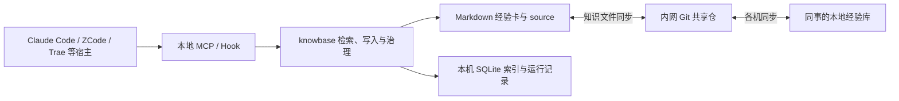

# 薪火 knowbase 项目介绍

> 部门内部交付版｜2026-10-22  
> 面向业务方、评审同事及首次了解本项目的成员。本文按运行版本 `0.2.0rc6`（固定运行环境 `~/.knowbase/runtime/venv`）整理；实际安装包、宿主接线和验收进度以维护者发布的版本及真实任务验证为准。

## 1. 项目概述

### 1.1 项目背景

我们已经在日常研发中使用 AI 编程工具，但经验往往留在一次对话里：换个会话、换个工具，同样的坑要重新排查一遍；同事已经解决的问题，其他人并不知情。

| 日常问题 | 对工作的影响 | 薪火的处理方式 |
|---|---|---|
| 同一个报错换个会话又重新排查 | 重复分析相同原因 | 保存问题、适用条件、处理动作和验证证据，下次先查 |
| Claude Code、ZCode、Trae 各自保留上下文 | 切换工具后经验难以接续 | 通过统一 MCP 工具访问同一份本地经验库 |
| 同事已经解决的问题，其他人不知道 | 团队反复试错 | 通过内网 Git 同步经验卡，各机建立本地索引 |
| 经验过时，但 AI 仍照旧执行 | 错误建议反复出现 | 按知识版本绑定反馈，失效条目退出默认检索 |
| 原始资料很多，真正的结论难找 | 文档越多，上下文越拥挤 | 原始材料保真留存，可复用结论单独成卡 |

### 1.2 建设目标

**薪火是一个供 AI Agent 共用的经验记忆库：把工作中验证过的排查方法、技术决策、操作流程和业务规则整理成经验卡，让后续任务能找到、核对并复用。**“一个人的坑，成为团队可以复用的经验。”

目标按三个层次推进，且明确区分“源码已具备”与“真实任务已验证”：

1. **个人可用：** 不同 AI 工具共用一份本机经验，减少跨工具重复排查。
2. **团队共享：** 成员通过内网 Git 共享经验卡，各自机器可检索，新成员直接继承踩坑遗产。
3. **可验证的收益：** 记录检索、阅读、采纳、验证四层证据，用真实任务对照回答“是否真的省时间”，没有对照数据时不虚报节省比例。

### 1.3 项目范围

适合沉淀的内容：环境兼容问题的排查方法、接口使用的前置条件、重复操作的固定步骤、架构选择的原因，以及有明确出处的业务规则。

明确不做的：不替代文档系统（原始材料以 source 层保真留存，不混入知识检索）；不自建模型服务（提炼由当前宿主的模型完成，knowbase 只做校验、查重与治理）；不做通用语义理解（当前向量为字符特征方案，同义改写仍需人工与任务验证）；一次性进度、测试通过总数、能从仓库直接查到的事实不作为经验卡沉淀。

## 2. 建设单位与相关方

本项目为部门内部自研，无外部承建单位。相关方与职责如下：

| 相关方 | 职责 |
|---|---|
| 部门（建设方） | 确认试点范围、数据使用要求与推广决策 |
| 维护者 | 构建并发布固定安装包，管理内网经验数据仓、远端白名单与 scope 命名，审核标准 / 偏好提案，执行升级与备份策略 |
| 成员使用者（接入方） | 在本机安装固定包并接入自己的 AI 宿主，在真实任务中检索、使用、反馈经验 |
| AI 宿主（Claude Code / ZCode / Trae 等） | 通过 MCP 调用统一工具，执行判断、核对、提炼与报告 |
| knowbase 服务端 | 校验结构、查重、控制写入、绑定版本与回执、执行确定性治理策略 |

分工边界：宿主 Agent 负责判断相关性、核对条件、执行任务与报告结果；服务端负责规则执行；人负责业务来源确认、争议裁决与治理审核。标准和偏好由 Agent 提案后进入 `staging` 待人审，Agent 不能直接改写已生效的治理规则。

## 3. 业务与功能介绍

### 3.1 总体业务流程：一条经验如何被复用

以“某接口升级后，旧客户端仍发送秒级时间戳，导致验签失败”为例（说明性场景，具体单位以真实接口契约为准）：

1. **解决问题并留下证据。** 核对接口版本、请求样本和签名规范，确认问题原因与修复结果。
2. **提炼成卡。** 说明什么版本需要毫秒级时间戳、旧版接口是否适用，以及如何验证请求。
3. **先查重再保存。** 已有同主题卡就补充原卡；新结论再保存，并记录来源与版本。
4. **共享到其他成员。** 本地保存、Git 提交、远端推送和同事拉取分别有独立结果。
5. **在下一次任务中检索。** Agent 按当前项目和报错查询，读卡并核对适用条件。
6. **实际使用后反馈。** 完成任务验证后，才报告“有帮助”“不适用”或“已失效”。

检索命中、阅读、采纳和验证成功是四件不同的事，薪火分别记录，避免把“被看到”当成“有效”。

### 3.2 核心功能模块

| 模块 | 提供的能力 | 业务价值 |
|---|---|---|
| 检索复用 | `memory_search` 词法 + 字符 n-gram 模糊双路召回、RRF 融合，按 scope / 可信度 / 新鲜度 / 反馈排序；`memory_read` 全文读回；`memory_context` 长任务分阶段补查 | 换会话、换工具后经验可接续；长方案不只开场查一次 |
| 沉淀与提炼 | `memory_save` 保存结论卡；`memory_capture` 观察入队；`memory_job_claim / job_material / job_submit` 领取批次、分页读取、提交候选；`memory_import` 导入原始材料 | 长材料不必一次性人工精读，提炼后读回真实卡片 ID 才算成卡 |
| source 与经验卡分层 | 原始文档、日志、代码保真留存于 source 层，默认不混入知识检索（ADR-0002） | 文档可追溯，结论可检索，互不污染上下文 |
| 反馈治理与自动演进 | `memory_use` 记录参考 / 采纳 / 无关 / 待验证；`memory_feedback` 绑定知识版本、使用回执与稳定任务结果 ID；版本绑定验证达到阈值自动晋升，负面证据触发 `stale` 退出默认检索 | 有效经验越用越可信，过时经验自动退场；同一任务重试不重复累计证据 |
| 团队共享 | 经验卡与治理提案经内网 Git 同步；各机本地索引日常读取；推送先 fetch、可合并自动 rebase 重放，仅真实内容冲突停止并保留本地提交 | 同事的经验在本机可直接检索；同步失败不丢本地成果 |
| 看板与统计 | 本机离线 HTML 看板（调用、命中、更新、Token 用量、自动演进卡片）；团队统计走显式导出 / 导入 / 回执核对 | 使用情况可视；工具标签不冒充人数，缺失数据保持未知 |

自动演进的当前默认值：普通新卡需至少 **3 个独立已完成任务、2 个会话**的版本绑定正向证据方可晋升；业务规则候选还须有出处并允许自动激活的配置。两个独立任务的 `not_helpful`，或一条版本绑定的 `incorrect` / `outdated`，会使知识进入 `stale` 并退出默认检索。人工 `promote / verify / revise / archive` 通道保留。

### 3.3 经验卡里写什么

新卡统一包含八项内容，目的是让没有参加原始讨论的人也能判断该不该用：

| 小节 | 要回答的问题 |
|---|---|
| 结论 | 下次遇到相同问题，应记住什么？ |
| 解决的问题 | 当时的现象与影响是什么？ |
| 适用条件 | 哪个系统、版本、状态或前提下有效？ |
| 不适用条件 | 有哪些例外，什么时候不能照做？ |
| 可执行动作 | 使用者具体要检查或执行什么？ |
| 关键证据 | 哪个输入、输出、条款或代码位置支持结论？ |
| 验证情况 | 在什么环境下，用什么方法验证到了哪一步？ |
| 未知与待确认 | 还有什么没有确认？ |

知识类型：踩坑 `pitfall`、决策 `decision`、流程 `workflow`、标准 `standard`、偏好 `preference`、业务规则 `bizrule`。“测试通过”不能替代验证说明，“参见某文档”不能替代关键证据。

### 3.4 用户角色与典型使用场景

- **个人开发者：** 在 Claude Code 排查过一个内网代理问题并保存成卡，一周后在 ZCode 里遇到同类报错，Agent 检索命中并按卡核对适用条件后直接执行。
- **团队成员：** 接入团队库后，新机器上先 `reindex`，直接检索到同事沉淀的环境兼容卡，跳过重复试错；自己补充边界条件后推送共享。
- **维护者：** 通过 `doctor`、`stats`、看板掌握各机使用情况；审核 staging 提案；按单版本原地升级策略发布新包并组织隔离库复验。

## 4. 技术架构简介

### 4.1 总体架构与技术栈

MCP 可以理解为 AI 工具调用外部能力的统一接口。各宿主通过标准输入输出启动本地 knowbase 服务，调用同一组检索、读写和反馈工具。

| 技术 | 在项目中承担的职责 | 对使用者的意义 |
|---|---|---|
| Markdown + frontmatter | 保存卡片正文、类型、范围和治理信息 | 内容可读、可迁移、可审查 |
| Git | 记录知识变更，支持各机共享 | 可以追踪修改并处理版本冲突 |
| SQLite FTS5 | 本地全文检索与结构化记录 | 不需要单独部署数据库服务 |
| 字符 n-gram 向量、RRF 融合 | 补充字面模糊召回，融合候选名次 | 降低完全依赖原词匹配的限制 |
| MCP | 向不同 AI 宿主提供统一工具（当前 16 个） | 接入不绑定某一家模型 |
| Hook | 在宿主事件发生时提醒、检索或观察 | 减少完全依靠模型主动记忆的遗漏 |

### 4.2 部署形态与环境

每位成员在本机运行服务：共享的是知识文件，日常读取使用本机索引；Git 同步失败时本地已保存内容不会被撤销。运行环境为 `~/.knowbase/runtime/venv`，**全机只保留一个运行版本，升级原地安装**，安装前备份数据与配置。`serve` 由宿主经 stdio 启动，不需要 HTTP 端口。

数据分三层：**共享层**（经验卡、治理提案及约定纳入的 source）、**本机层**（配置、索引、使用回执、会话观察、统计日志、备份）、**汇总层**（显式导出并核对回执后的最小价值事件）。程序代码仓与经验数据仓是两个仓库，经验数据只使用批准的内网远端（白名单校验，误配公网会被拒）。Markdown 是知识内容的唯一真相；SQLite 含可重建索引和不可从 Markdown 恢复的本地运行记录，“索引可重建”不代表可以随意删除数据库。Agent 读到的经验可能进入宿主模型上下文，使用什么模型、允许处理什么材料，按部门数据使用要求执行。凭据脱敏：`privacy-scrub` 先私有备份再清洗，历史库已执行 rc6 清洗。

## 5. 项目成果与价值

### 5.1 交付物清单

| 交付物 | 说明 |
|---|---|
| 固定安装包 | `knowbase-0.2.0rc6` wheel，由维护者构建并统一发布 |
| 源码仓与文档 | 程序源码、README、本《项目介绍》与《软件接入使用手册》 |
| 内网经验数据仓 | 团队共享知识文件仓及远端白名单策略 |
| MCP 服务与 16 个工具 | 检索、读写、执行中上下文、提炼、使用、统计全套接口 |
| 离线看板与团队统计 | 本机 HTML 看板；价值事件导出 / 导入 / 回执核对流程 |
| 验收协议 | 三宿主真实样本验收协议、宿主能力记录 |

### 5.2 成果与效益

建议分三个层次看数据，每层明确“不能直接推出什么”：

| 层次 | 关注的问题 | 不能直接推出什么 |
|---|---|---|
| 使用情况 | 有多少调用、命中和知识更新？ | 命中不等于采纳 |
| 有效复用 | 哪些任务实际使用，并验证有效？ | 工具来源数不等于人数 |
| 净收益 | 相比不用经验库，是否减少时间、Token 或遗漏？ | 没有对照时，不能报节省百分比 |

已有实测（维护者本机真实库，2026-09 至 10 约 5 周，单人本机口径）：检索类调用 668 次，任务验证 `helpful` 反馈 19 条，`memory_context` 阶段补查自动命中约占 34%。该数据不能外推为团队收益。团队级三人跨机复用与净收益对照仍待试点验收。

当前源码的请求级用量采集支持 Claude 本地 transcript；ZCode、Trae 的对应采集入口明确返回不支持、不估算填充，缺失数据保持未知。

### 5.3 创新点

1. **source 与经验卡分层**（ADR-0002）：原始材料保真留存、结论单独成卡，检索不被原文淹没。
2. **版本绑定的反馈闭环**：使用与任务结果绑定具体内容版本，正文更新后旧验证不沿用，杜绝“被看到即有效”。
3. **确定性自动演进**：独立任务证据达阈值自动晋升、负面证据自动退场，同时保留人工治理通道；工具标签仅归因、不冒充人员身份。
4. **四链路证据分离**：检索命中、阅读、采纳、验证成功分别记录，统计口径诚实。
5. **单版本固定运行环境**：全机唯一 `~/.knowbase/runtime/venv` 原地升级，避免并行版本漂移。

## 6. 项目实施情况

### 6.1 里程碑

- 2026-09：核心检索 / 保存 / Git 共享链路上线；source 与经验卡分层（ADR-0002）落地。
- 2026-10 上旬：执行中检索 `memory_context`、增量提炼队列、价值事件协议进入实现验证。
- 2026-10 中旬：团队价值链路 H0～V4 完成并通过五轮对抗评审（累计 566 项测试）。
- 2026-10-22：rc6 发布——凭据脱敏边界修复，真实库完成历史清洗；运行时统一为单版本 `0.2.0rc6`。

### 6.2 当前状态

| 范围 | 当前可确认的情况 | 分享口径 |
|---|---|---|
| 核心实现 | 当前源码注册 16 个 MCP 工具，覆盖检索、写入、执行中上下文、提炼、使用和统计 | 具备本地实现，运行服务需核对版本 |
| ZCode | 已有受控任务中的执行中注入与消费证据，以及有界材料提炼样本 | 已有局部真实证据，完整验收仍有待办 |
| Claude Code | 已有 MCP / Hook 注册记录和本地请求用量来源 | 配置注册不能替代真实消费验收 |
| Trae | MCP 已接线；当前源码有 Hook 适配与本地测试 | 真实整链未验收前按主动调用的辅助模式介绍 |
| 业务规则自动演进 | 当前源码具备版本绑定验证与自动激活、淘汰策略 | 不代表所有已运行的固定包都已升级 |
| 凭据安全 | `privacy-scrub` 默认只读盘点，`--apply` 先备份后清洗；真实库已完成 rc6 清洗 | 新增写入的凭据拦截已生效 |
| 跨成员与净收益 | 已有协议、汇总实现及本地验证材料 | 三位真实成员复用、净效果对照仍待验收 |

上述进度依据仓库内的能力记录和验收文件；现有历史分享稿中“三段式卡片”“所有规则必须人工激活”等表述已不能完整代表当前源码。

## 7. 后续规划

### 7.1 部门试点

先选择一个真实项目，邀请三位使用不同宿主的同事参与，由一位维护者提供固定安装包、内网数据仓和统一 scope：

1. A 解决一个有复用价值的问题，保存经验并确认已同步。
2. B 在另一台机器的真实任务中检索、核对并使用，记录任务结果。
3. C 遇到边界条件或版本变化，补充证据，检查旧反馈是否正确隔离。
4. 对照不用经验库的过程，记录额外检索成本、遗漏和实际收益。

### 7.2 后续方向

- 完成 Trae 真实整链验收与 Hook 现场触发证据；推进 Windows 真机验收。
- 请求级用量采集扩展到 ZCode / Trae 入口；净收益对照试点。
- 按单版本原地升级策略滚动发布，升级后一律隔离库复验再切正式库。

## 8. 进一步阅读

- [软件接入使用手册](integration-guide.md)：安装、宿主配置、首次验收、升级与排障。
- [项目 README](../../README.md)：命令和能力总览。
- [宿主能力记录](../host-capabilities.md)：真实证据与待验收项。
- [消费与统计协议](../inflight-consumption-metrics.md)：版本、回执与统计口径。
- [统计卡片与自动演进方案](../dashboard-confidence-evolution.md)：当前源码的治理与展示规则。
- [三宿主真实样本验收协议](../team-value-real-acceptance.md)：部门试点的完整验收要求。
- [rc6 凭据脱敏修复记录](../credential-redaction-2026-10-22.md)：清洗操作说明。
